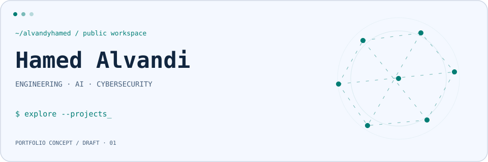
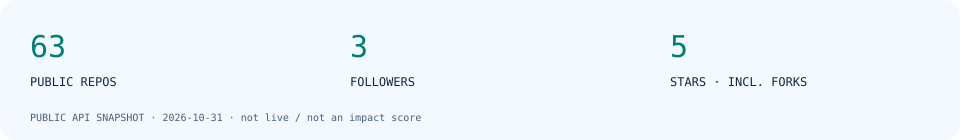

<picture>
  <source media="(prefers-color-scheme: dark)" srcset="assets/hero-dark.svg">
  <source media="(prefers-color-scheme: light)" srcset="assets/hero-light.svg">
  
</picture>

# Hamed Alvandi

[GitHub](https://github.com/alvandyhamed) · [Public repositories](https://github.com/alvandyhamed?tab=repositories)

> **DRAFT PROFILE** — proposed positioning and project selection await owner approval.

## 01 / Public workspace

**Engineering · AI · Cybersecurity** — draft positioning for this portfolio.

Three independent tracks: mobile and web engineering; AI experiments and automation; application security and security tooling. These are proposed areas of focus, not verified professional titles.

The public profile bio lists Android, Java, Kotlin, React Native, React and Python. Career history, seniority, leadership, client work and business results are intentionally pending confirmation.

## 02 / Selected repositories

These are public repository links, not claims of production readiness or sole authorship. Descriptions below are draft editorial labels unless explicitly attributed.

| Repository | Evidence / proposed framing | Status |
| --- | --- | --- |
| [singbox-proxy-dashboard](https://github.com/alvandyhamed/singbox-proxy-dashboard) | Repository description: self-hosted dashboard for subscriptions, traffic, routing and monitoring. | Public, non-fork; case study draft |
| [MyDashboardNext](https://github.com/alvandyhamed/MyDashboardNext) | TypeScript repository; proposed web/dashboard showcase. | Public, non-fork; description draft |
| [AI_Regresion_Model](https://github.com/alvandyhamed/AI_Regresion_Model) | Python repository; proposed AI experiments slot. No model-quality claim. | Public, non-fork; description draft |
| [react-native-jalali-date-picker-rtl](https://github.com/alvandyhamed/react-native-jalali-date-picker-rtl) | Repository description: Jalali date picker for React Native. | **Fork**; contribution scope unverified |

## 03 / AI & Automation

**Draft focus:** model experiments, OCR exploration and automation. No accuracy, deployment, client or research claims are made.

- [AI_Regresion_Model](https://github.com/alvandyhamed/AI_Regresion_Model): public Python repository; proposed regression experiments case study (**draft**, role and results pending).
- [OcrModelNemberDetect](https://github.com/alvandyhamed/OcrModelNemberDetect): public repository; proposed OCR exploration case study (**draft**, inferred from repository name; scope pending).

## 04 / Cybersecurity

**Draft focus:** application security, vulnerability analysis and security tooling. These are portfolio themes, not certifications or verified engagements. Tool names do not establish effectiveness.

- [Api_Scanner](https://github.com/alvandyhamed/Api_Scanner): public Go repository; proposed API security tooling case study (**draft**, inferred from name; capabilities pending review).
- [xss_finder](https://github.com/alvandyhamed/xss_finder): public Shell repository; proposed XSS tooling case study (**draft**, inferred from name; capabilities pending review).

## 05 / Public GitHub snapshot

<picture>
  <source media="(prefers-color-scheme: dark)" srcset="assets/stats-dark.svg">
  <source media="(prefers-color-scheme: light)" srcset="assets/stats-light.svg">
  
</picture>

Snapshot only. Repository count includes forks. Stars sum public owned repositories including forks; these are not personal contribution or impact measures. [Machine-readable values](assets/stats.json).

## 06 / Connect

Find me on [GitHub](https://github.com/alvandyhamed). Additional contact channels will be added after verification.
